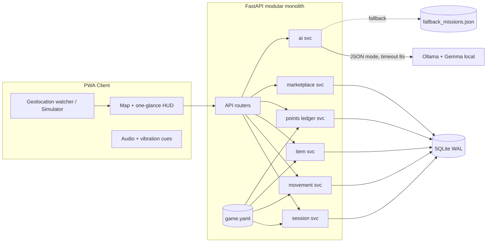

# ARCHITECTURE & SYSTEM DESIGN

## 1. Stack (chosen for speed + fewest failure modes; change only via MEMORY.md decision entry)
| Layer | Choice | Why |
|---|---|---|
| Backend | Python 3.11+, **FastAPI**, Uvicorn | Fast to write, typed, auto-docs |
| DB | **SQLite** (WAL mode), plain `sqlite3` + small repo layer | Zero setup, real transactions, `BEGIN IMMEDIATE` for atomic writes |
| Validation | **Pydantic v2** | Request + AI-output schema validation |
| Frontend | Static **PWA**: HTML + vanilla JS (ES modules) + **Leaflet** + OSM tiles. No build step | Avoids bundler/tooling loops |
| AI | **Ollama** serving a **Gemma** model (open weights), called over `http://localhost:11434` | Local, no data leaves device |
| Tests | `pytest`, `httpx` TestClient | |
| Config | `config/game.yaml` + `.env` | Rules are data, not code |
| Deploy (optional) | Render for front+API only (AI stays local → state this) | Stretch |

> Gemma tag: agent must run `ollama list` / `ollama pull` and pick an available Gemma tag that fits the machine RAM (try the smallest first). Record the exact tag + measured latency in MEMORY.md. Do not guess.

## 2. Component diagram


## 3. Directory layout (target)
```
tg-trails/
  README.md
  .env.example
  config/game.yaml
  config/fallback_missions.json
  server/
    main.py
    settings.py
    db.py            # connection, migrations runner, tx helper
    migrations/001_init.sql
    routers/ (session.py movement.py items.py points.py market.py ai.py admin.py)
    services/ (session.py movement.py items.py points.py market.py ai.py)
    domain/   (states.py geo.py rules.py)   # pure functions, no I/O
    schemas.py
  web/
    index.html  app.js  map.js  hud.js  cues.js  sim.js  style.css  manifest.json
  scripts/ seed.py  simulate_walk.py  sample_walk.json
  tests/ test_state.py test_movement.py test_collect.py test_ledger.py test_redeem.py test_ai.py
  docs/ PROGRESS.md (symlink/copy rule: root copy is canonical)
```
Pure logic lives in `domain/` so it is unit-testable without DB or HTTP.

## 4. State machines
**Session:** `IDLE → PREPARING → ACTIVE ⇄ PAUSED → COMPLETED` ; `ACTIVE|PAUSED → INVALIDATED` (explicit reason code only). Terminal: COMPLETED, INVALIDATED. Transition table lives in `domain/states.py`; any other transition raises `InvalidTransition`.
`ITEM_AVAILABLE` is **not** a session state in our build; it is derived (`session.cycle_progress_s >= cycle_required_s` and an item is `AVAILABLE`). Fewer states, fewer bugs. (Decision D-03)

**SpawnedItem:** `LOCKED → AVAILABLE → COLLECTED | EXPIRED`.
**Reward:** `DRAFT → PENDING_APPROVAL → ACTIVE ⇄ PAUSED → OUT_OF_STOCK | EXPIRED | RETIRED` (MVP seeds directly as ACTIVE).
**Redemption:** `REQUESTED → CONFIRMED → FULFILLED | CANCELLED | EXPIRED` (MVP: created as CONFIRMED atomically).

## 5. The timer (resolved)
Two separate clocks:
- `session_elapsed_s` — wall-clock outdoors time. Display + stats only. **Never grants items.**
- `cycle_progress_s` — sum of **qualifying movement seconds** since last collect. When `>= cycle_required_s` (default 300; demo 20) the next item flips `LOCKED → AVAILABLE`.
Collect → `cycle_progress_s = 0`, next item spawn scheduled. Failed collect → no reset, 5 s retry cooldown. Session end keeps ledger points. All counters computed **server-side** from samples.

## 6. Movement qualification (server-side, `domain/movement.py`)
Input: ordered samples `{t, lat, lon, accuracy_m}` posted in batches (every ~5–10 s).
Per consecutive pair (A→B), `dt = B.t - A.t`, `d = haversine`, `v = d/dt`:
1. Drop sample if `accuracy_m > max_accuracy_m` (30), or `t` ≤ previous (out-of-order/stale), or server-receive skew > 60 s.
2. If `dt > max_gap_s` (30): segment is **non-qualifying** (don't interpolate).
3. If `v > impossible_speed_mps` (12): flag `IMPLAUSIBLE`, exclude; 3 flags in 5 min → session `PAUSED(reason=implausible)` (never an instant ban).
4. If `v > max_walk_speed_mps` (3.5, allows jog): non-qualifying (vehicle-like).
5. If `v < min_walk_speed_mps` (0.5) **or** `d < noise_floor_m` (accuracy-scaled): stationary → pauses cycle timer.
6. Else segment qualifies: add `dt` to `cycle_progress_s` and `d` to `distance_m`.
Also require cumulative displacement from cycle start `>= min_displacement_m` (75) before an item can unlock (stops GPS-jitter walking-in-place).
Client may also send step-count/activity hint → **optional extra evidence only**, never sufficient alone.
Every reject stores a `reason_code` in `movement_events` (explainable).

## 7. Item spawn
- On cycle start, server picks rarity by weighted config, picks a point at distance `[spawn_min_m, spawn_max_m]` (default 80–250 m) from user's latest valid position, bearing random, min separation from previous spawns `>= min_separation_m` (50).
- Locations are **not checked against private property** (no data). Mitigation: tiny radius, copy says "stay on public paths", user can skip/re-roll item (skip costs nothing, awards nothing). Documented limitation.
- Collect range: `collect_radius_m` (30) **plus** reported accuracy cap (accuracy must be ≤ 30 m).
- `available_at` set when cycle unlocks. Marker visible earlier as "locked ghost" (optional).

## 8. Points ledger
Table `point_transactions` is append-only. Balance = `SUM(delta)` per user (cached column allowed but must be recomputed in tests to match).
Collect transaction (single `BEGIN IMMEDIATE`):
1. lookup `idempotency_key` in `collections` → if exists return prior result (200, `replayed:true`).
2. verify session ACTIVE, item AVAILABLE & not collected, proximity, limits.
3. insert `collections`, update item `COLLECTED`, insert `point_transactions(+base_points)`, reset cycle, schedule next.
4. commit. Unique constraints: `UNIQUE(idempotency_key)`, `UNIQUE(spawn_id)` on successful collections.

## 9. Marketplace
Redeem (single `BEGIN IMMEDIATE`): check reward ACTIVE + in window + `stock>0`, check balance `>= cost`, decrement stock, insert `redemptions(code=ULID/short random)`, insert `point_transactions(-cost, ref=redemption_id)`. Idempotency key required. Any exception → full rollback. Code format `TG-XXXX-XXXX` (crypto-random). Mark "DEMO — not redeemable".

## 10. AI service contract
Endpoint `POST /api/ai/mission` body: `{minutes, interest, intensity, environment}` →
Ollama `/api/chat` with `format` = JSON schema, `stream:false`, `options.temperature≈0.7`, timeout 8 s.
Pydantic schema:
```
Mission { title: str(5..60), description: str(20..280), est_minutes: int(5..60),
          intensity: Literal["easy","moderate"], tip: str(<=120),
          item_lore: str(20..200) }
```
Validation extras: banned-term filter (no "private property", "trespass", "cross the road while looking", no traffic/dangerous-terrain suggestions, no claims about current weather/conditions), `est_minutes <= requested*1.25`. One retry with error feedback, then fallback from `config/fallback_missions.json`. Response includes `source: "gemma-local" | "fallback"` and `latency_ms`. The mission is **flavor + optional bonus goal**; it never changes points (bonus, if any, is a fixed config value applied by backend on a backend-checked criterion like distance).

## 11. Security & privacy
- Token auth (random bearer per installation); rate limit on `/session/*`, `/collect`, `/redeem` (in-memory token bucket).
- Raw GPS samples: keep only the last N (200) per session, purge on session end + 7-day TTL; ledger keeps only derived stats.
- Never expose other users' locations (there are no other-user views in MVP).
- No secrets in repo; `.env.example` only.
- Admin routes behind `ADMIN_TOKEN` env.

## 12. Observability
Structured JSON logs (request id, session id, decision, reason_code). `GET /api/health` shows DB ok + Ollama reachable + model tag. `audit_events` table for admin actions & point adjustments.

## 13. Schema (SQLite)
```sql
users(id TEXT PK, created_at, display_name, status)
installations(id TEXT PK, user_id FK, token_hash, created_at, last_seen)
sessions(id PK, user_id FK, state, started_at, ended_at, paused_reason,
         session_elapsed_s, cycle_progress_s, cycle_required_s,
         distance_m, cycle_start_lat, cycle_start_lon, invalid_reason, config_snapshot_json)
movement_events(id PK, session_id FK, t, lat, lon, accuracy_m, verdict, reason_code, seg_speed_mps)  -- TTL purge
item_definitions(id PK, name, category, rarity, base_points, weight, active, description)
spawned_items(id PK, item_id FK, session_id FK, lat, lon, status, spawned_at, available_at, expires_at, collected_at)
collections(id PK, session_id FK, spawn_id UNIQUE-when-success, user_id FK, idempotency_key UNIQUE,
            result, reason_code, points, created_at)
point_transactions(id PK, user_id FK, delta, kind, ref_type, ref_id, created_at, note)
sponsors(id PK, name, status)
rewards(id PK, sponsor_id FK, title, description, cost_points, stock, state, valid_from, valid_to, terms)
redemptions(id PK, user_id FK, reward_id FK, code UNIQUE, status, idempotency_key UNIQUE, created_at, fulfilled_at)
missions(id PK, session_id FK, source, payload_json, latency_ms, created_at)
audit_events(id PK, actor, action, detail_json, created_at)
```
Indexes: `point_transactions(user_id)`, `spawned_items(session_id,status)`, `movement_events(session_id,t)`, unique constraints above.

## 14. API (v0.1)
```
POST /api/auth/anon                 -> {user_id, token}
POST /api/session/start             -> session
POST /api/session/{id}/pause|resume|end
POST /api/session/{id}/samples      -> {accepted, rejected[], cycle_progress_s, item_state}
GET  /api/session/{id}              -> state + next item hint (distance/bearing only when AVAILABLE)
POST /api/session/{id}/collect      {spawn_id, lat, lon, accuracy_m, idempotency_key}
GET  /api/points                    -> {balance, recent[]}
GET  /api/rewards                   -> active rewards
POST /api/rewards/{id}/redeem       {idempotency_key}
GET  /api/redemptions
POST /api/ai/mission
GET  /api/health
POST /admin/rewards, /admin/adjust  (ADMIN_TOKEN)
```
Error body always `{error_code, message, retry_after_s?}`; messages are user-explainable ("Item is 48 m away").

## 15. Offline truth table (publish this)
| Capability | Offline? |
|---|---|
| Game logic, ledger, redemption (server on same machine/LAN) | Yes, if server runs locally |
| Gemma mission/lore | Yes (Ollama local) |
| Map tiles | Only previously cached tiles |
| Phone ↔ laptop server | Needs same Wi-Fi/hotspot |
| Fully standalone phone w/o server | **No** (out of scope; offline point sync deliberately deferred to avoid forged transactions) |
