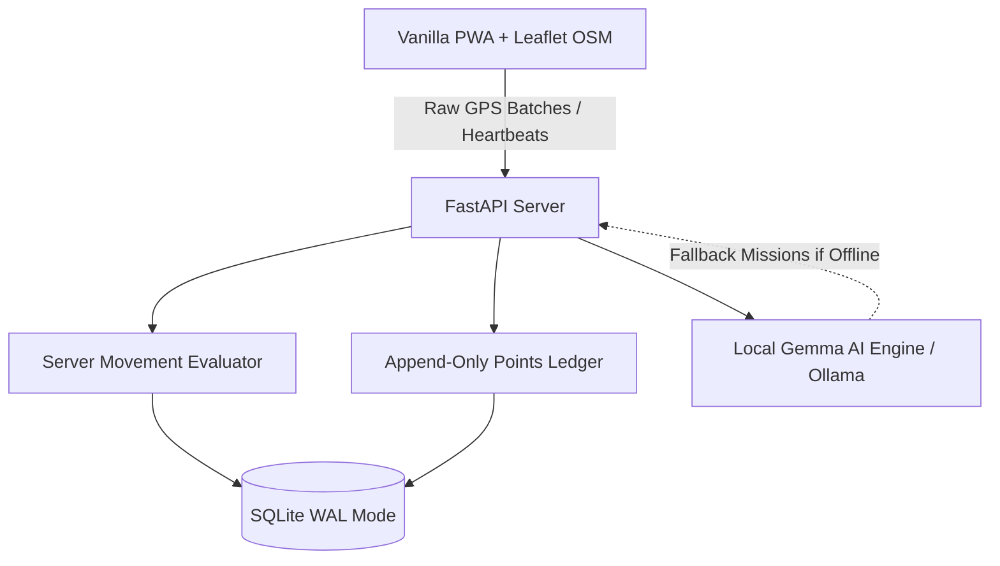

*This is a submission for the [Hacktoberfest Open-Source AI Challenge Week 1: Touch Grass](https://dev.to/challenges/hacktoberfest-week1-2026-10-05)*

# TG Trails (OutLoot): Turning Screen Time into Verified Loot with Local Gemma AI & Open-Source Maps

My phone vibrated with a gentle double chime at minute six of an evening stroll through the neighborhood park, and I hadn't looked at the screen once. 

When I reached into my pocket, the bottom sheet was glowing with a freshly unearthed trail relic: a *Clover Sprout* (+10 pts) and a snippet of local botanical lore penned moments earlier by a local open-weight Gemma model running directly on my machine. No battery-draining screen vigilance, no endless push notification doom-scrolling. Just genuine foot movement turned into game progression.

This is **TG Trails (OutLoot)**.

---

## 1. What I Built

Most fitness or location-based games commit one of two sins:
1. They demand you stare glued to your glass screen while walking across busy crosswalks.
2. They rely on simple client countdowns or step counters that can be easily spoofed from a desk chair or while driving in traffic.

**TG Trails** flips that dynamic completely. It is a screen-light, server-authoritative exploration game designed for developers and knowledge workers who spend 8+ hours a day staring at terminals and need a compelling, gameful reason to step away and touch grass:

* **Server-Authoritative Movement Engine:** Your phone collects GPS samples, but the client never decides your progress. The server evaluates raw coordinates against physics filters (speed between 0.5–3.5 m/s, GPS accuracy $\le$ 30m, sample interval $\le$ 30s, and a minimum displacement threshold of 75m).
* **Local Gemma AI Missions & Item Lore:** An open-weight Gemma model (served locally via Ollama) writes customized walking missions, outdoor tips, and mythic relic lore. If Ollama is offline or uninstalled, the game degrades to deterministic fallback missions without failing.
* **Real-Time Active Screen Time & Grass Debt:** Built-in engagement heartbeats track when you are active on screens. When you exceed your chosen threshold (e.g., 30 minutes), a "Touch Grass" alert modal prompts you to step outside. You can even sync your daily device hours from **Google Digital Wellbeing** to compute your lifestyle Grass Debt.
* **Live Leaderboards & Friends Squad:** Compete with friends on real-time leaderboards ranked by Grass Score (`points + outdoor_mins * 2`), see friends' live outdoor walk stats, and send tactile `🌱 Nudge` notifications to remind teammates to step outside.
* **Double-Entry Points Ledger & Rewards:** Points earned from verified drops are recorded in an append-only ledger with cryptographic idempotency keys. Redeem points for demo sponsor perks (e.g., Trailhead discounts, sticker packs) with unique voucher codes.

---

## 2. Demo

* **Live GitHub Repository:** [https://github.com/devanshu-puri/OutLoot](https://github.com/devanshu-puri/OutLoot)
* **Local Web App:** Vanilla JS + CSS + Leaflet running over FastAPI at `http://127.0.0.1:8000/`.
* **Zero External API Keys:** Powered by 100% free, community-hosted **OpenStreetMap (OSM)** and local open-weight AI.

---

## 3. Architecture & How I Built It

The application is structured into four decoupled layers:

### The Technical Stack:
* **Backend:** Python 3.12+ / FastAPI, Pydantic v2 schemas, SQLite in WAL mode with foreign keys and strict transaction managers (`tx()`).
* **Frontend:** Vanilla HTML5 + CSS3 + Leaflet 1.9.4 with zero build steps or bundlers.
* **Open-Source Mapping:** Pure OpenStreetMap standard tiles (`https://tile.openstreetmap.org/`) combined with a custom CSS contrast/inversion filter (`filter: invert(100%) hue-rotate(180deg) brightness(82%) contrast(108%)`) to provide a sleek, high-contrast dark mode map with **zero commercial API keys and zero watermarks**.
* **AI Engine:** Google's Gemma (`gemma4:12b` / `gemma2:2b`) running via Ollama locally. Requests are validated strictly against Pydantic schemas with an 8-second timeout, input sanitization against banned exploit phrases, and a 12-mission fallback pack.
* **Test Suite:** **60 green pytest unit tests** covering state transitions, geodesic haversine math, ledger double-entry math, replay-attack prevention, and AI fallbacks, accompanied by an 11-step end-to-end integration test runner (`tests/verify_mvp2.py`).

---

## 4. Real-Time Screen Time, Thresholds & Android Digital Wellbeing

One of the core requests of the challenge was measuring real screen time against outdoor physical activity.

### A. Real-Time Screen Time Heartbeats
The client listens for user engagement (`mousemove`, `keydown`, `touchstart`, `visibilitychange`). Every 15 seconds, the client sends an active heartbeat to `POST /api/screentime/heartbeat`. The server tracks continuous screen streaks against the user's configurable threshold (15m, 30m, 45m, 60m). When the threshold is crossed, a frosted-glass **Touch Grass Alert Modal** appears with a gentle audio chime. Starting an outdoor walk immediately resets the streak to zero!

### B. Android Digital Wellbeing Sync & Grass Debt
Because Android's Digital Wellbeing does not have a public one-tap REST API, OutLoot provides an Android Wellbeing sync extractor (`POST /api/screentime/import`). You enter today's screen hours (e.g., 4.5 hours from your Digital Wellbeing dashboard), and OutLoot computes your **Grass Debt** (15 minutes of outdoor walking per hour of screen time).

### C. Live Friends Squad & Nudges
Friends can be added by user ID or display name (`POST /api/friends/add`). The social tab displays friends' live walking status, outdoor minutes, and an interactive **`🌱 Nudge`** button that delivers real-time notifications (`"Step away from the IDE and touch grass with me!"`) to a teammate's screen.

---

## 5. Why Does Open Innovation Matter?

1. **True Location Privacy:** Geolocation data and outdoor habits are sensitive. When using cloud-based proprietary AI APIs, sending location-adjacent context leaks behavioral patterns to third-party servers. With an open-weight Gemma model running locally, prompts never leave your device.
2. **Deterministic Fairness + Creative Lore:** Game mechanics (points, eligibility, fraud prevention, vouchers) must remain 100% deterministic code. Open architecture allows confining the AI strictly to storytelling (missions, tips, relic lore) without giving a non-deterministic LLM authority over balances or state.
3. **Zero API Cost & Total Offline Resilience:** Proprietary APIs introduce rate limits, credit expiration, and network failure points. OutLoot runs with zero API keys. When out in remote park trails with spotty cell reception, the game operates seamlessly.
4. **No Commercial Watermarks:** When third-party tile providers (like CartoDB) suddenly add watermark overlays demanding commercial API keys, an open-source architecture allows switching directly to community OpenStreetMap tiles and applying client-side CSS dark styling in minutes.

---

## 6. Honest Limitations & Developer Trade-Offs

* **Browser Background GPS:** Mobile browsers throttle or suspend geolocation timers when the phone screen is locked. We mitigate this using the Screen Wake Lock API and audio/haptic cues so the screen can stay awake at minimum brightness while in your pocket.
* **GPS Accuracy Jumps:** Near tall concrete buildings, GPS drift can simulate movement. We added an accuracy filter ($\le$ 30m) and speed caps (0.5 to 3.5 m/s) to discard erratic jumps.
* **Demo Sponsor Vouchers:** Rewards in the marketplace are non-monetary promotional demonstration vouchers with cryptographic redemption codes.

---

## 7. My Agent Session

This project was built collaboratively with Google DeepMind's **Antigravity** agent, utilizing the DevRelay unified gateway for tests, schema migrations, and session management.

* **Git Repository:** [https://github.com/devanshu-puri/OutLoot](https://github.com/devanshu-puri/OutLoot)

---

## 8. Prize Categories

* **Open-Source AI Challenge Week 1: Touch Grass**
* **Best Use of Gemma** (Local Gemma model generating JSON missions, walking tips, and drop relic lore with zero cloud dependencies)
